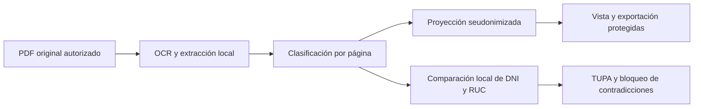

# Extracción, segmentación, privacidad y cruce de anexos

Este documento utiliza la numeración de la nueva tabla del trabajo: HU-01 a HU-03 para ingreso (S1–S4) y HU-04 a HU-05 para auditoría (S5–S7). No reemplaza los identificadores históricos de resolución y enrutamiento del backend.

## Alcance implementado

**HU-01 — Extracción local.** PyMuPDF y RapidOCR extraen texto y campos sin API key. Se preservan los controles de tamaño, número de páginas, DPI e ilegibilidad. La carga guarda el original y los resultados mediante los puertos existentes.

**HU-02 — Clasificación y separación.** Se clasifican FUT, DNI, planos y recibos con título y etiquetas reconocibles. Los formatos ambiguos siguen DESCONOCIDO. Se conserva una unidad por página para evitar mezclar dos DNI o dos formularios diferentes sin evidencia de continuidad. Cada unidad puede descargarse como PDF real desde el original, con las páginas correspondientes y acceso del evaluador. No se afirma agrupación semántica de anexos multipágina.

**HU-03 — Proyección protegida al ingreso.** Después del OCR/extracción local, se construye una proyección del texto y los campos: DNI, RUC, nombres etiquetados, domicilios, teléfonos, correos y fechas de nacimiento etiquetadas. Se usan seudónimos consistentes dentro del mismo expediente para mantener la comparación entre anexos. No se persiste un diccionario inverso de tokens. Los originales se conservan por separado de la proyección y continúan disponibles para el circuito autorizado.

La interfaz muestra campos protegidos por defecto. El evaluador puede solicitar ver los originales y exportarlos mediante una acción identificada. La exportación principal contiene campos protegidos, evita copiar el nombre original del archivo y no incluye el texto original. Al cambiar de expediente se restablece la vista protegida.

**HU-04 — TUPA y prevención de conformes contradictorios.** Se mantiene el catálogo piloto verificado contra el TUPA aportado y el modo académico de evidencias ficticias. Una contradicción cruzada impide habilitar el enrutamiento o emitir la demostración, incluso si los requisitos individuales se marcaron CUMPLE. Se genera un borrador de observación de consistencia. El catálogo no certifica autenticidad de firmas/pagos ni vigencia normativa completa.

**HU-05 — Cruce al cargar.** Se comparan DNI y RUC explícitamente extraídos entre anexos y se advierte si una página contiene varios DNI etiquetados. Cada alerta identifica anexos y páginas, mostrando valores protegidos. Se distinguen datos insuficientes, ausencia de contradicciones en lo comparado y diferencias que requieren revisión. No se atribuye fraude: un representante, un pagador distinto o un error de OCR pueden explicar la diferencia. La contradicción debe revisarse y corregirse en los anexos; no se añadió un botón que la descarte sin trazabilidad.

## Flujo y privacidad

El OCR debe leer localmente los caracteres para identificar los datos. No se envían originales, imágenes, texto ni proyecciones a proveedores de IA. `transmision_externa_habilitada` y `envio_a_ia_externa` permanecen false.

Esta técnica es **seudonimización local parcial**, no una garantía de anonimización. Puede omitir nombres sin etiquetas, direcciones no reconocidas, documentos de identidad con formatos distintos o texto personal libre. Los PDFs descargados contienen los datos originales y no están redactados visualmente. Los originales siguen existiendo en SQL/almacenamiento; el proyecto no añade cifrado de archivos ni autorización individual por expediente, y el acceso sigue usando el mecanismo de revisor del prototipo.

La Ley 29733 se toma como marco de referencia, sin certificar cumplimiento legal integral. Para un uso municipal real deben revisarse finalidad/base del tratamiento, acceso individual, conservación, seguridad del almacenamiento y procedimientos aplicables. Fuentes oficiales: [Ley 29733](https://leyes.congreso.gob.pe/DetLeyNume_1p.aspx?xNorma=6&xNumero=29733) y [Reglamento aprobado mediante DS 016-2024-JUS](https://busquedas.elperuano.pe/dispositivo/SE/2349653-1).

## Contrato HTTP y compatibilidad

POST/GET de expedientes incorporan campos aditivos `privacidad`, `consistencia` y `segmentacion`. Los registros anteriores se leen con valores predeterminados y se calcula la proyección al consultarlos, sin migraciones de tablas. El agregado persiste los informes junto con la extracción para nuevas cargas.

Se implementó y probó esta ruta nueva, sin asumir una ruta inexistente:

`GET /api/expedientes/{dossier_id}/documentos/{index}/pdf`

`index` empieza en cero y corresponde al orden de `documentos`. Devuelve application/pdf, Cache-Control=no-store, 404 para índice/expediente/original inexistente y 503 ante un fallo de recuperación. Reutiliza la protección de carga/consulta de expedientes cuando PROTECT_DOSSIER_ROUTES=true. No utiliza tokens en URLs. La descarga se realiza con Bearer desde el adaptador frontend. Los segmentos se generan al solicitarse, sin duplicar originales en disco.

Los JSON de expedientes también llevan Cache-Control=no-store. Se conservan la arquitectura hexagonal, el contrato previo, Supabase, CORS, los diagnósticos y la demostración universitaria.

## ¿Hace falta Gemini o GPT?

**No para lo implementado.** El OCR es real y local; comparar DNI/RUC no necesita un LLM y produce resultados reproducibles con evidencia de páginas. No se añadieron claves, dependencias de proveedores ni variables de IA remota.

Gemini o GPT podrían ampliar la extracción semántica o la redacción, con un adaptador de salida y un contrato de resultados validado. Ambos proveedores documentan salida estructurada: [Gemini](https://aistudio.google.com/docs/structured-output), [OpenAI](https://developers.openai.com/api/docs/guides/structured-outputs). Esa ampliación no está conectada en esta entrega. Antes de habilitar envíos sería necesario definir qué datos pueden salir y verificar la protección del contenido: el filtro parcial actual no autoriza transmitir texto libre. Las claves se configurarían exclusivamente en Render, nunca en VITE ni en Git.

## Demostración y pruebas

El ZIP del portal ahora contiene ocho PDFs. En `08-inconsistencia-dni.pdf`, el recibo ficticio contiene un DNI diferente al formulario/DNI. Al cargar, revisar el informe protegido; al auditar, comprobar que no queda CONFORME. El ejemplo consistente permite contrastar ambos resultados. La separación se demuestra descargando el segmento RECIBO_PAGO, que contiene únicamente su página.

Pruebas: **87 backend y 42 frontend aprobadas**, incluyendo privacidad automática, tokens consistentes, contradicciones, varias identidades, insuficiencia de datos, bloqueo del falso conforme en modo normal y académico, lectura de agregados antiguos, permisos/errores del PDF, exportación protegida y comunicación HTTP real con FastAPI local. TypeScript, build Vite, compileall y pip check aprobados. Dos advertencias de deprecación de Starlette/AnyIO no producen fallos.

Los PDFs ficticios actualizados se renderizaron y revisaron visualmente; la interfaz se verificó con DOM de pruebas. No se hizo una comprobación visual en navegador real ni se procesaron expedientes personales en producción.

## Despliegue

Fusionar/publicar primero el backend y después el frontend. No se requiere una API key ni una variable nueva para esta ampliación. Mantener PROTECT_DOSSIER_ROUTES=true y el almacenamiento persistente de los originales para permitir sus descargas. ACADEMIC_DEMO=true solo se necesita para los recorridos universitarios simulados ya documentados.
